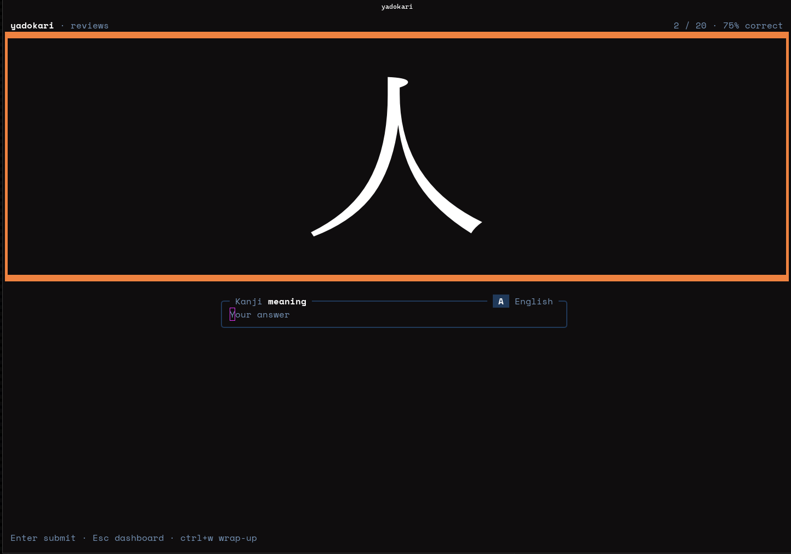

<p align="center">
  
</p>

<h1 align="center">yadokari</h1>

<p align="center">
  <a href="https://www.wanikani.com">WaniKani</a> reviews and lessons in your terminal,<br>
  with kanji drawn large.
</p>

<p align="center">
  <a href="https://github.com/dotmatrx/yadokari/actions/workflows/ci.yml"></a>
  <a href="https://github.com/dotmatrx/yadokari/releases/latest"></a>
  <a href="https://pkg.go.dev/github.com/dotmatrx/yadokari"></a>
  <a href="LICENSE"></a>
</p>

<p align="center">
  
</p>

> yadokari is an **unofficial** WaniKani client, not affiliated with WaniKani or
> Tofugu LLC. It talks to WaniKani's public API with your own token; the content it
> shows is covered by [WaniKani's terms](https://www.wanikani.com/terms).

## Features

- Reviews and lessons in the terminal, with WaniKani's answer checking (typo
  tolerance, warnings for readings vs meanings), wrap-up and undo of a typo.
- Large kanji drawn as images in terminals with kitty graphics (Ghostty, kitty, Rio),
  plain text elsewhere. Optional **font roulette**: each question in a different
  Japanese typeface (gothic, mincho, textbook, handwritten).
- Pronunciation audio, item pages with mnemonics, a dashboard with the review
  forecast.
- Works offline: answers are queued and sent on the next sync.
- Themes: WaniKani's colours, yadokari's own (electric, or the calmer blackbox),
  your terminal's palette, or high contrast. `NO_COLOR` is respected.

yadokari (宿借り) is a hermit crab: it lives in a borrowed shell, as this app lives
in your terminal. The icon is 宀, the roof radical at the top of 宿 (yado, lodging),
sheltering a prompt.

## Install

**Homebrew (macOS and Linux):**

```sh
brew install dotmatrx/tap/yadokari
```

`brew upgrade` keeps it up to date.

**Linux and macOS (download):** take the archive for your system from
[Releases](https://github.com/dotmatrx/yadokari/releases), unpack it and put
`yadokari` on your `PATH`. On macOS, a downloaded binary is unsigned: clear the
quarantine flag once with `xattr -d com.apple.quarantine yadokari`.

**With Go 1.27+:**

```sh
go install github.com/dotmatrx/yadokari/cmd/yadokari@latest
```

Windows isn't supported.

## First run

yadokari asks for a WaniKani [personal access token](https://www.wanikani.com/settings/personal_access_tokens).
For reviews and lessons, tick **reviews:create** and **assignments:start** when you
create it; a token without them only shows the dashboard. The token is kept in your
system keyring (or a `0600` file where there is none); `yadokari --logout` removes it.
`WANIKANI_API_TOKEN` overrides it.

## Use

| Screen | Keys |
|---|---|
| Dashboard | `r` reviews · `l` lessons · `s` sync · `q` quit |
| Review | `Enter` submit / next · `Tab` show the answer · `i` item page · `p` audio · `ctrl+w` wrap up · `Esc` dashboard |
| Lesson | `←` `→` tabs and items · `Enter` on the last item starts the quiz |

Readings are typed in romaji and converted to kana as you type, as on WaniKani.
`yadokari --sync` syncs and prints a summary without the interface.

## Settings

Optional, in `~/.config/yadokari/config.toml`. Every key is described in
[`docs/config.example.toml`](docs/config.example.toml): review order and session
size, answer strictness, undo (Backspace after a typo), lesson batch size, autoplay,
audio player, graphics, fonts and font roulette, themes and single colours.
Unset settings follow your preferences on the WaniKani website.

## Requirements

- **A terminal with kitty graphics** for large kanji: [Ghostty](https://ghostty.org),
  [kitty](https://sw.kovidgoyal.net/kitty/) or [Rio](https://rioterm.com). Other
  terminals, WezTerm included, get the plain tier
  (kanji in the terminal's own font). Force either with `--gfx kitty|plain`.
  Light and dark terminals both work: yadokari asks the terminal for its
  background and text colours. `yadokari --terminal` shows what it found.
- **A Japanese font** for the kitty tier: Hiragino on macOS; Noto Sans CJK JP on
  Linux (Fedora `google-noto-sans-cjk-fonts`, Debian/Ubuntu `fonts-noto-cjk`). For
  font roulette, install more (Noto Serif CJK JP, IPAex Mincho/Gothic, or Google
  Fonts' Klee One and Yomogi); variable fonts (`*-VF.ttc`) can't be used.
- **An audio player** for pronunciations: `afplay` (built into macOS), `pw-play`,
  `paplay`, `ffplay` or `mpv`.

Data lives in `~/.local/share/yadokari/`: the cache database, `writes.log` (every
review and lesson start sent, with WaniKani's reply) and `yadokari.log` (problems,
in full).

## Development

Go 1.27 and [just](https://github.com/casey/just). `just` lists the recipes:
`just test`, `just check`, `just build`. Development runs against a fake API
(`just mock --demo`, then `just dev`). Submitting a review or starting a lesson can't
be undone, so development builds (`go run`, `just run`, `just dev`, `just build`)
never write to WaniKani; only installed builds (`just install`, releases,
`go install …@vX.Y.Z`) do. [`AGENTS.md`](AGENTS.md) describes the code layout and
the rules for coding agents; planned work is in the
[issues](https://github.com/dotmatrx/yadokari/issues). See
[CONTRIBUTING.md](CONTRIBUTING.md) to help, and [SECURITY.md](SECURITY.md) to report
a vulnerability.

## License

[MIT](LICENSE).
